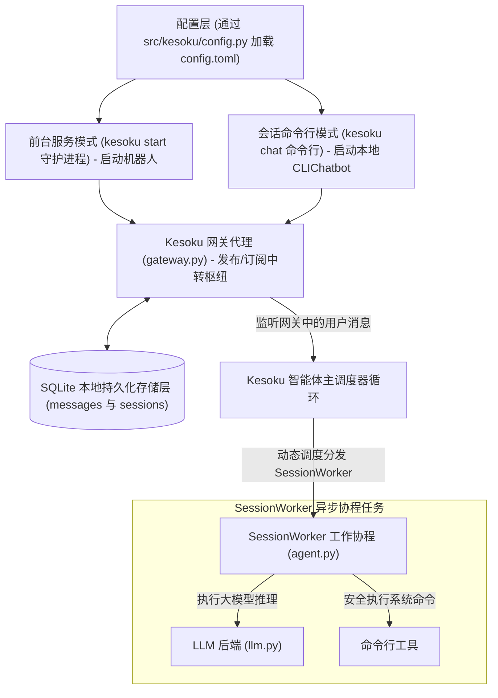

# 系统架构与并发设计

本技术文档详述了 Kesoku AI Agent 的核心系统架构设计、异步并发管理模型以及防卡死消息抢占中断逻辑。

---

## 🏛️ 架构设计全景图

Kesoku 围绕**解耦的网关代理（Broker Gateway）架构**进行组织，将前端消息收发与后端大模型推理任务完全解耦：

---

## ⚙️ 核心并发模型与防卡死抢占机制

为了保证多用户访问、长网络延时或耗时工具调用状态下，智能体能够提供流畅、安全的应答，Kesoku 设计了精密的并发管理方案：

### 1. 无状态 Pub/Sub 代理中转
网关通过 `post(message)` 进行数据持久化，同时通过 Python 的 `asyncio` 异步生成器将消息实时推送到活动的 `listen(**filters)` 监听通道中。这种解耦方式保证了各个机器人适配器可以只负责前端交互渲染，不用关心底层 Agent 推理的状态。

### 2. 独占式 SessionWorker 任务调度
当 Agent 主调度程序监听到新的用户消息时：

*   它会首先检查当前 `session_id` 是否拥有活动的 `SessionWorker` 任务。
*   如果没有，系统会即时实例化一个 Worker 协程，负责该会话在后台的串行回合迭代。
*   如果已有 Worker 协程正在运行，新消息会被直接塞入该 Worker 的内部异步队列中，等待下一步骤处理，防止产生多线程读写锁冲突。

### 3. 工具执行原子性与思维抢占中断策略
*   **工具调用不可强杀**：为了保证宿主机系统状态的一致性与安全性（例如 Agent 正在调用 Shell 工具修改代码或写入文件），所有的工具执行（Tool Execution）都被视为原子步骤。一旦工具开始运行，系统绝不会中途强杀进程，而是会在工具返回结果、重新回到推理状态机的关卡时，才会执行安全检查。
*   **思维抢占中断**：当大模型处于深度推理（Chain-of-Thought）或者正在等待下一次接口调用时，如果检测到 Worker 队列中涌入了新的用户 Prompt，系统会立即丢弃后续已排队的中间计划，中断当前 turns，将未完成的推理标记为 `interrupted`，并在新的一轮中优先响应用户的插话指令。

### 4. 基于Turn Root的时间轴重排序
为了完美恢复被中断的话题线，且防止异步并发执行的工具结果在持久化日志中产生时间轴交错，Kesoku 将会话消息记录按照联合排序索引 `(root_message_timestamp, message_timestamp)` 进行逻辑重排，确保每一次话题追溯的上下文都符合逻辑连贯性。

---

## 🛠️ 编码工具、上下文分层压缩与子智能体委派

### 1. 编码工具套件与首尾保留截断 (P0)
*   **首尾保留截断 (`truncate_middle`)**：对长 Shell 输出及历史工具输出保留前 40%（命令与头部信息）和后 60%（异常堆栈与测试汇总），避免关键报错被尾部截断丢失。
*   **`read_file` 与增强版 `update_file`**：`read_file` 提供带行号的分段读取（`offset`/`limit`）、二进制检测、目录列表提示及模糊文件名建议；`update_file` 支持 `$STAGING_DIR`/`$AWD` 变量展开、自动剥离误粘的行号前缀、未匹配时的最近似行号提示，并在成功修改后返回精简 Unified Diff。
*   **静态 `# Available Skills` 提示词索引**：会话创建时在系统提示词中生成单行技能目录（`- **[name]**: description`），使模型无需先调用 `list_skills()` 即可直接调用 `use_skill(skill_name)`。

### 2. 面向任务续接的分层压缩与状态快照 (P1)
*   **结构化续接摘要 (`HistoryCompressor`)**：Level-0 与高层摘要包含 `Summary`、`Key Decisions & Rationale`、`Dead Ends (Do Not Repeat)`、`Pending State` 以及 `External Files`，防止压缩后重复已失败的尝试或丢失后台进程/端口/分支状态。
*   **注水算法 `<recent_user_messages>`**：在 `recent_user_messages_total_chars`（默认 12,000 字符）预算内通过注水分配完整保留短用户消息、对超长消息做中间截断。
*   **每轮冻结状态快照 (`state_snapshot.py`)**：每轮自动注入 `<context name="running_jobs">`、`<context name="repo_rules">` 以及压缩后的 `<context name="staging_artifacts">`，并在单轮内保持字节级稳定以命中隐式前缀缓存。
*   **`/compact [instructions]` 命令**：支持用户手动触发即时压缩并传入自定义保留重点。

### 3. 后台任务管理、仓库规范发现与子智能体 (P2)
*   **`manage_job` 工具**：支持对后台 Shell 任务执行 `list`、`status` 和进程组级 `kill`（`SIGTERM` -> `SIGKILL`），并在主动终止任务时抑制冗余唤醒通知。
*   **按需 `AGENTS.md` / `GEMINI.md` 规范发现与 `[hooks]`**：`RepoRulesManager` 沿访问路径向上至 `$AWD` 自动发现仓库规范文件并注入 `<context name="repo_rules">`，在修改仓库文件后触发一次性结束检查提醒，并支持 `[[hooks.post_tool_use]]` 与 `[[hooks.stop]]` 自动化门禁。
*   **`delegate_subagent` 子智能体委派**：启动隔离的只读 `SubagentRunner` 循环（前台 Shell 超时保护、完整轨迹写入 `subagent_<id>.log.yaml`），仅向主会话返回 `<= 1500` 字符的精炼调查报告。

### 4. `kesoku-bench` 评测基准
`benchmarks/kesoku_bench/` 提供包含 16 个端到端任务的评测套件（`A1`–`A4`、`B1`–`B4`、`C1`–`C4`、`D1`–`D4`），支持确定性行为评分、`MeteredLLM` 成本/Token 核算与分阶段消融评测（`baseline`、`p0`、`p1`、`p2`）。
